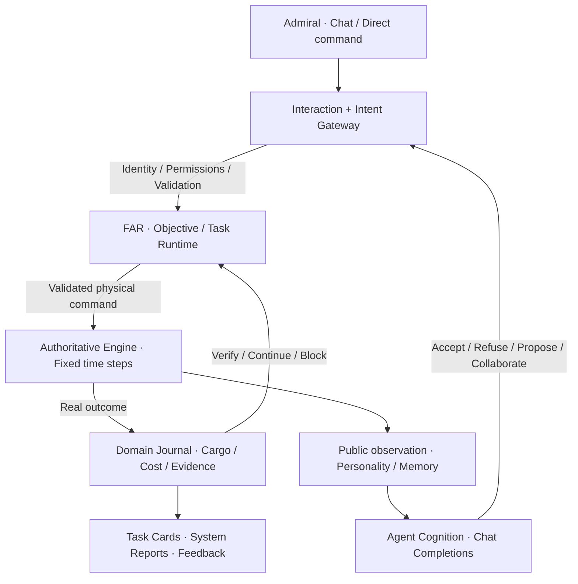

<p align="center">
  <a href="./README.md">简体中文</a> · <a href="./README.en.md"><strong>English</strong></a>
</p>

<p align="center">
  
</p>

<h1 align="center">Frontier Command</h1>

<p align="center"><strong>You command the frontier. Your agents decide whether to follow.</strong></p>

<p align="center">
  A single-player, agent-driven MMO ecosystem simulation<br/>
  Electron · React · TypeScript · LCARS 26 Classic · v1.6.0 / Save v16
</p>

<p align="center">
  <a href="#the-game-in-30-seconds">The game</a> ·
  <a href="#a-story-the-simulation-can-tell">Gameplay</a> ·
  <a href="#quick-start">Quick start</a> ·
  <a href="#architecture-where-decisions-become-consequences">Architecture</a> ·
  <a href="#agent-demo">Agent demo</a> ·
  <a href="#verification-and-honest-limits">Limits</a>
</p>

> **Not a strategy game with a chatbot glued onto it.** Agents observe a limited world, weigh personality, risk, relationships and memories, and can accept, refuse, negotiate or initiate actions. Their structured decisions must pass validation and be executed by an **authoritative simulation engine** with real travel, inventory, combat, costs and consequences.

## The game in 30 seconds

You are the **Admiral**, managing a Federation frontier: ships, Dawn Starbase, mines, colonies and the people assigned to operate your fleet. Battle and Logistics Agents make their own choices. Romulan Border Command complicates diplomacy, while the Orion Syndicate survives by observing, intercepting, stealing, selling and replenishing **actual cargo**.

| Activity | What makes it matter |
| --- | --- |
| **Explore** unknown sectors and investigate anomalies | Information must be discovered; surveyed sites and confirmed wormholes change future plans. |
| **Mine and haul** physical Materials | Deposits, local capacity, ship cargo, reservation and delivery are all accounted for. |
| **Command and fight** | Escort, intercept, shadow, attack or seize facilities using physical ship capabilities and persistent damage. |
| **Build and grow** | Establish facilities, refit ships, train cadets and develop Agent skills and relationships. |
| **Disrupt a pirate economy** | Orion raids need scouting, working ships, cargo, safe retreats, black-market liquidity and actual repairs. |

## A story the simulation can tell

Suppose Mira must haul Materials from a frontier mine to Dawn, but the quickest route exposes her freighter to a possible Orion interception.

1. **You state the objective.** Mira evaluates the observable risk, her current ship, motivation, fatigue and relationships. She may accept, refuse or suggest escort conditions.
2. **Agents negotiate.** Mira can request help from a Battle Agent. The recipient can independently accept, refuse or counteroffer. Any reward must be approved by the Admiral and held in a real escrow budget.
3. **Rules execute the commitment.** Frontier Agent Runtime (FAR) tracks the objective, steps and evidence. The game engine performs repairs, rendezvous, loading, travel, wormhole transit and unloading without calling an LLM every simulation tick.
4. **The opposition reacts.** Orion uses sensor observations and relayed intelligence to attempt piracy. Stolen cargo has to survive the trip home before it can support the pirate economy.
5. **Consequences persist.** Actual delivery, losses, commitments, XP, trust, stress and relationships affect the next decision.

This is **an example of an emergent gameplay chain**, not a scripted outcome. Agent decisions and wording depend on model responses and current context; physical outcomes obey the engine's rules.

## Four things that make Frontier Command different

### 01 / Agents are operators, not ships

The starting roster includes **Talia (Battle)** and **Mira (Logistics)**. Their careers influence competence and priorities rather than imposing artificial bans on physically valid actions. Persistent individual state includes motives, long-term goals, task preferences, risk tolerance, fatigue, trust, stress and remembered events.

Model cognition handles meaningful choices, task judgment, proposals and collaboration, while local schema, authority and capability checks gate every action. Agents may refuse. A ship assignment is persistent and can be changed explicitly. Unassigned Agents do not burn tokens through autonomous background polling. Routine movement and inventory updates do not trigger LLM calls or noisy chat reports.

### 02 / Goods do not teleport

```text
Explore → Discover deposits → Build mine → Extract Materials
          → Load a real freighter → Choose routes → Deliver to Dawn
          → Build ships / Repair / Upgrade → Explore farther
```

Mines have a **3,000-Materials storage limit** and stop producing when full. Colonies chiefly generate Credits. Ships have finite cargo and real loading/unloading time, reservations, transit risk and potential losses. The frontier, fleet and Agents each have different development paths that alter subsequent gameplay.

### 03 / Pirates are not timed loot piñatas

The Orion Syndicate deploys scouts, raiders, interceptors, a corsair and a smuggler, supported by hidden bases and a finite resource economy. Its cycle is **observe → share intelligence → assemble → extort/board → transport stolen cargo → sell and service → expand**. Route changes, protection, injuries, warehouses and the black market alter what the pirates can do. **Orion's tactical and economic AI is deterministic; it does not call an LLM.**

### 04 / The world remembers

Seeded sectors reveal only what has actually been observed. Navigation considers Warp, different route risks and *discovered, confirmed* wormhole exits. Romulan vessels are not automatically legal enemies; border incidents can affect politics. Ship destruction can be permanent. Provenance, commitments, transaction evidence and historical events survive saves.

## Architecture: where decisions become consequences

**FAR is not a second physics engine.** It is the persistent boundary between an Agent's intent and an actual result in the world.



| Boundary | Responsibility |
| --- | --- |
| **Cognition** | Make meaningful, LLM-driven decisions using permitted public context. |
| **Intent Gateway** | Resolve and validate proposed goals, entity references and authority. |
| **FAR** | Own persistent objectives, dependencies, steps, interruptions, recovery and completion proofs. |
| **Authoritative Engine** | Advance combat, navigation, production, logistics, society and deterministic opponents. |
| **Domain Journal / Reply Coordinator** | Attribute actual events, prevent duplicate accounting and associate one primary reply with one directed request. |

The simulation supports **1× / 4× / 16×** game speed. You can explore, haul, build and exercise direct command **without an API key**; model-driven autonomy is used when genuine judgment is required.

**Technical references:** [FAR architecture](docs/agent-core-v2-architecture.md) · [FAR delivery and audit](docs/agent-core-v2-delivery.md) · [Engine architecture](docs/architecture.md) · [Worldbuilding](docs/worldbuilding.md) · [Acceptance matrix](docs/acceptance.md)

## Quick start

**Windows is the primary development and tested desktop target.** Install Node.js (a current LTS is recommended), npm and Git.

```powershell
git clone https://github.com/yinminghao08/frontier-command.git
cd frontier-command
npm ci
npm run dev
```

Or build and start Electron with `npm start`. A fresh world starts **paused at DAY 1 00:00**. Begin by surveying, hauling real Materials from the Helios mine or inspecting the shipyard. Then unpause the world. Model configuration is optional for manual play.

<details>
<summary><strong>Build, test and package</strong></summary>

```powershell
npm run build       # TypeScript + Vite + Electron
npm test            # Vitest
npm run test:e2e    # Playwright + Electron; extra dependencies may be needed
npm run package     # Windows unpacked app in release/ (--win --dir)
```

These commands are documented from `package.json`; they have not been rerun solely for this README change.

</details>

## Agent demo

For a compact vertical slice of **autonomous choice → executed work → persistent feedback**:

1. Open **Save Manager → AGENT DEMO** to create an isolated demo save.
2. Go to **CONSOLE SETTINGS → AGENT API**. Set a compatible OpenAI Chat Completions endpoint, your key and preferred model; each Agent may override the model and reasoning settings.
3. In Mira's private chat, send: **“请评估当前矿场运输与护航风险。”** (“Please assess the current mine-haul and escort risk.”)
4. Inspect **REQUESTS**, **Task Cards** and **SYSTEM REPORTS**. Approve any agreed budget/escort conditions, and advance simulation time.
5. Observe actual loading, escort, delivery, losses, relationship changes and new choices. Save and restore to test persistent execution.

See the full [demo walkthrough](demo/README.md). The scenario **does not script an Agent's answer**. Without a configured model, autonomous task judgment remains unavailable; Admiral direct commands still work. Third-party API calls can incur charges.

## The original GeekTech challenge

Built for the **“Agent-era MMO simulation management game”** challenge: an intentionally **single-player simulation of an MMO ecology**, not a multiplayer MMO server.

| Challenge layer | Concrete slice |
| --- | --- |
| **Lv1 · Distinct tasks** | Combat, exploration, mining and hauling demand different capabilities, time, attention and risk. |
| **Lv2 · Growth loop** | Real Credits/Materials, infrastructure, ship modules and Agent progression influence future outcomes. |
| **Lv3 · Actual Agent decisions** | Two distinct initial Agents, task consent, negotiation, collaboration and validated structured actions. |
| **Lv4 · Management ecosystem** | Cadet recruitment and training, assignments, escrow-backed rewards, persistent organizational assets and pirate economy. |

**Deliberate tradeoff:** the Admiral retains an explicit supreme-command / direct-takeover capability. Autonomous consent and collaboration remain model-driven, and the two modes are distinguished rather than conflated. This is a design decision, not a claim that every optional challenge suggestion was implemented verbatim.

## Verification and honest limits

- **Recorded v16 verification:** the repository documents **472 passing Vitest checks** and **68 Electron E2E checks**. See the [verification record](docs/verification/v16/README.md); those results were not independently rerun for this documentation update.
- **API compatibility:** the app uses OpenAI-compatible Chat Completions. Keys remain in local Electron main-process protected storage; explicit unsupported reasoning configurations raise an error rather than silently pretending to take effect. Real provider compatibility, latency and token cost vary and must be verified separately.
- **Saves:** version-16 timelines include protected migration paths and task/cargo evidence. The Save Manager currently has **no cloud sync or import/export workflow**.
- **Platform / scope:** Windows-focused, single-player, no hosted multiplayer server and no bundled free LLM. Seeded simulation rules can be repeatable, but model responses are not guaranteed to be identical.
- **License / third-party IP:** `package.json` currently specifies **UNLICENSED**; do not assume an MIT/Apache license or a public redistribution grant. See [references](docs/references.md), the [Antonio license](docs/ANTONIO-OFL.txt) and [font notices](fonts/NOTICE.md). This is an unofficial science-fiction fan project with no affiliation with the Star Trek rights holders.

---

<p align="center">
  <strong>Frontier Command</strong><br/>
  <sub>Not every order is obeyed. Every consequence is real.</sub><br/>
  <a href="./README.md">阅读中文版</a> · <a href="./docs/agent-core-v2-architecture.md">Explore FAR</a> · <a href="./demo/README.md">Try the demo</a>
</p>
