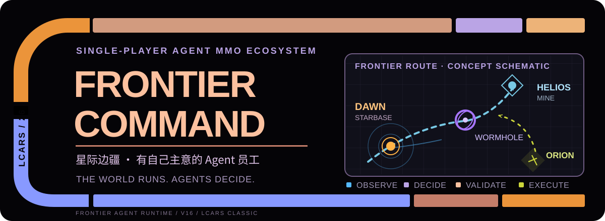

  <a href="./README.md"><strong>简体中文</strong></a> · <a href="./README.en.md">English</a>

  

<h1 align="center">Frontier Command · 星际边疆</h1>

  一款让 LLM Agent 负责舰船和任务的单机星际经营模拟。

  模型在需要判断的节点做决定，游戏引擎负责航行、库存、战斗、结算和存档。

  <code>Electron</code> · <code>React</code> · <code>TypeScript</code> · <code>LCARS 26 Classic</code> · <code>v1.6.0 / Save v16</code>

## Quick start

目前主要开发和验证 Windows 桌面版。准备好 Node.js、npm 和 Git 后：

\`\`\`powershell
git clone https://github.com/yinminghao08/frontier-command.git
cd frontier-command
npm ci
npm run dev
\`\`\`

也可以用 \`npm start\` 完整构建后启动 Electron。

新世界从 **DAY 1 00:00** 暂停开始。先看看 Dawn Starbase、Helios 矿场和舰队，再解除暂停推进时间。没有配置模型 API 也能探索、运输、建设和直接指挥舰船。

## 你在游戏里做什么

你是 Dawn Frontier Command 的 Admiral。手里的资源不是一串抽象积分，而是舰船、设施、库存、航线和一群有自己判断的 Agent。

- 测绘未知 Sector，调查异常，确认虫洞出口，逐步扩大可用星图。
- 从矿场装走实际库存，把 Materials 运回基地，用于造舰、维修、改装和建设。
- 安排巡逻、护航、拦截、秘密跟踪和战斗。舰船受真实参数、弹药和损伤约束。
- 建矿场、前哨和殖民地，升级 Dawn Starbase，处理持续增长的边疆经济。
- 招募和培养 Agent，为他们分配舰船，和他们协商任务、风险与报酬。

游戏循环会自然把这些系统连在一起：

\`\`\`text
探索 → 发现资源 → 建设 → 开采 → 运输 → 生产与扩张
                                      ↓
                                航线变得更值钱
                                      ↓
                         海盗侦察、伏击、抢货和撤退
                                      ↓
                         护航、改线、追踪、打击补给链
\`\`\`

## Agent 有自己的判断

初始 Agent 包括 Battle 职业的 Talia 和 Logistics 职业的 Mira。职业代表专长，不会给物理上可行的行动加一层人为禁令。

每个 Agent 都有稳定人格和持续状态，包括风险偏好、任务偏好、疲劳、压力、信任、关系和记忆。你给出任务后，模型看到的是当前允许公开的世界信息。它可以接受、拒绝、提出条件，或请求另一名 Agent 协作。

模型的输出不会直接修改游戏状态。所有目标和动作都要经过本地校验，再交给权威引擎执行。

\`\`\`mermaid
flowchart LR
    A["Admiral 聊天 / 直接指挥"] --> B["Intent Gateway"]
    O["公开 Observation 人格 / 记忆 / 情报"] --> C["Agent Cognition"]
    C --> B
    B --> D["FAR Objective / Task Runtime"]
    D --> E["Authoritative Engine"]
    E --> F["Domain Journal"]
    F --> D
    F --> G["Task Cards / Reports"]
    E --> O
\`\`\`

模型只在任务判断、协商、重要危险和有意义的策略选择上工作。移动坐标、装卸货、采矿、战斗结算和普通进度由引擎推进，因此不需要每个 Tick 调一次模型。

## 一趟货运会发生什么

假设 Mira 要把 Helios 矿场的 Materials 运回 Dawn。

1. 你把目标发给 Mira。她会看到自己的舰况、当前风险、任务状态、关系和近期经历。
2. 如果她认为需要护航，可以向 Battle Agent 发起结构化协作请求。对方独立决定是否接受，也可以提出条件。
3. 条件达成后，FAR 保存目标、任务步骤、依赖和完成标准。引擎执行维修、会合、装货、航行和卸货。
4. Orion 只能利用自己实际侦察到并传递过的情报安排截击。抢到的货必须真的运回据点，才能进入它们的经济。
5. 交付量、损失、履约情况、经验和关系变化会进入存档，并影响之后的观察和判断。

结果取决于当时的世界状态和模型选择。演示存档只准备场景，不预写 Agent 的接受或拒绝。

## 世界模拟

### 物流

矿场有有限库存和仓储。Helios 的 Materials 容量是 3000，满仓后停止生产。舰船有货舱容量，装卸需要时间，运输途中可以发生真实货损。RETURN 会保留货物，明确交付才会卸货。

### Orion Syndicate

Orion 有自己的舰船、基地、库存、弹药和 Credits。它们用确定性 AI 侦察运输线、交换情报、集结、勒索或登舰抢货，再把战利品运回去销赃、维修和扩军。

摧毁 Orion 舰船会造成永久损失。切断补给点、跟踪返航舰找到基地，或者让高价值货运线路变得难以伏击，都会改变它们之后能做什么。

### 导航与情报

MOVE、HAUL、ESCORT 和 Agent 航行共用 Journey Planner。路径可以使用普通 Warp 和已经发现、确认出口的虫洞。未知出口不会提前泄露给自动规划。

地图和 Agent 观察只包含玩家已经获得的情报。隐藏基地、敌方内部目的地、反跟踪证据和随机源保留在主进程。

### 持久世界

舰损、货物来源、合同托管、任务证据、关系变化和重大事件都会写入版本化存档。v16 可以从受支持的旧时间线迁移，同时保留原文件和可验证的执行记录。

## Frontier Agent Runtime

FAR 管理“目标如何变成一个可以恢复、验证和完成的任务”。它不计算舰船伤害，也不替引擎移动货物。

| 组件 | 职责 |
| --- | --- |
| Cognition | 在需要模型判断时组织公开 Observation，并接收结构化决策 |
| Intent Gateway | 解析目标，核对实体、权限、能力和参数 |
| FAR | 保存 Objective、Task、依赖、队列、打断、修订、恢复和完成标准 |
| Authoritative Engine | 推进导航、战斗、库存、经济、建设、社会系统和敌方 AI |
| Domain Journal | 记录货物、成本、损失和完成证据，避免重复结算 |
| Reply Coordinator | 让一条定向消息只有一个主要回复，并正确处理取消和重试 |

更完整的实现说明：

- [FAR v16 架构](docs/agent-core-v2-architecture.md)
- [FAR 交付与审计记录](docs/agent-core-v2-delivery.md)
- [游戏引擎架构](docs/architecture.md)
- [世界规则](docs/worldbuilding.md)

## Agent API

在 **CONSOLE SETTINGS → AGENT API** 中配置 OpenAI Chat Completions 兼容接口。Base URL 可以是 API 根路径或完整 chat endpoint，每名 Agent 都可以单独覆盖模型与推理设置。

API Key 由 Electron 主进程保存，并使用系统 \`safeStorage\` 加密。Key 不会写进公开 Snapshot、聊天记录或世界存档。

Thinking 和 Reasoning Effort 会按模型能力处理。显式请求不受支持的设置时，应用会报错，不会静默忽略后再显示成“已关闭思考”。

第三方 API 可能产生费用。第一次试玩可以先选低成本模型。

## Agent demo

仓库带有一个固定 seed 的隔离演示场景：

1. 启动游戏，打开 **存档管理器 → AGENT DEMO / 演示存档**。
2. 配置 Agent API。
3. 在 Mira 私聊发送：\`请评估当前矿场运输与护航风险。\`
4. 查看 **REQUESTS**、Task Card 和 **SYSTEM REPORTS**，按实际协商结果决定是否批准条件。
5. 推进游戏时间，观察维修、会合、装货、虫洞航行、交付和关系变化。

完整步骤见 [demo/README.md](demo/README.md)。

## Development

常用命令：

\`\`\`powershell
npm run dev
npm run build
npm test
npm run test:e2e
npm run package
\`\`\`

这些命令分别做什么

- \`npm run dev\`：开发模式。
- \`npm run build\`：TypeScript 检查、Vite 构建和 Electron 主进程构建。
- \`npm test\`：Vitest 规则测试。
- \`npm run test:e2e\`：Playwright 启动真实 Electron 做端到端测试。
- \`npm run package\`：生成 Windows unpacked 应用目录。

v16 的仓库验收记录为 472 项 Vitest 测试和 68 项 Electron E2E 测试通过。测试使用隔离 userData 和本地 Mock provider，不读取玩家的生产 API 配置。详情见 [v16 verification](docs/verification/v16/README.md)。

## Project scope

- 单机游戏，没有多人 MMO 服务端。
- Windows 是目前主要开发和验证平台。
- 游戏不内置免费 LLM，Agent 自主判断需要用户自己的兼容 API。
- 固定 seed 可以复现确定性世界与规则，模型回复本身不保证一致。
- 存档管理器目前没有云同步和导入/导出功能。

## License and third-party material

\`package.json\` 当前标记为 \`UNLICENSED\`。仓库公开可见不等于授予 MIT、Apache 或其他开源许可证。

LCARS、字体和其他第三方素材的来源与声明见：

- [docs/references.md](docs/references.md)
- [docs/ANTONIO-OFL.txt](docs/ANTONIO-OFL.txt)
- [fonts/NOTICE.md](fonts/NOTICE.md)

Frontier Command 是非官方科幻题材 fan project，与 Star Trek 权利方没有官方关联。

  <a href="./README.en.md">English</a> ·
  <a href="./docs/agent-core-v2-architecture.md">FAR architecture</a> ·
  <a href="./demo/README.md">Demo guide</a>

