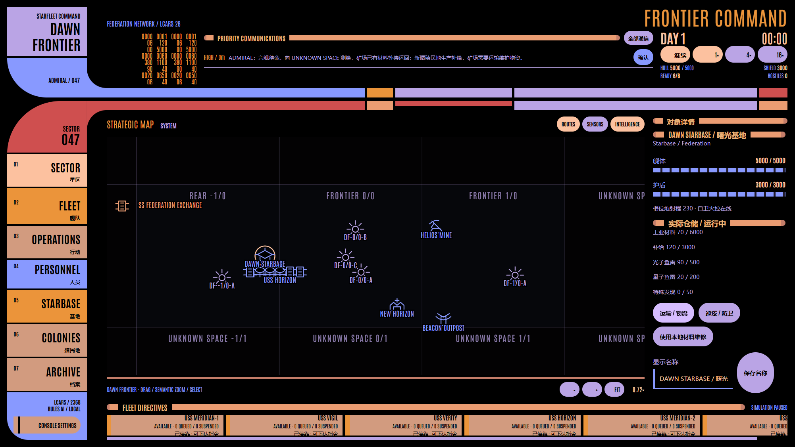

# STARFLEET: FRONTIER COMMAND

**Lv1 + Lv2 / v7 Dawn Frontier。玩家是拥有最终指挥权的 Admiral。**

六艘初始舰船共享一个持续世界：探索资源、建设矿场、运输真实库存、发展殖民地和舰队；经济活动吸引持久 Orion 资产，边境行动留下 Romulan 政治后果。人员使用规则培养和任职，本阶段没有 LLM 决策或 Lv3。



## 运行

```powershell
npm ci
npm run dev
# 或构建并运行 Electron
npm start
```

新世界暂停于 DAY 1 00:00，默认 1×。约一现实秒推进一游戏分钟；4× / 16× 只增加相同固定步次数。重启暂停，不离线推进。当前交付源码和构建，release 中的旧 EXE/ZIP 不代表 v7。

## 经济闭环

**EXPLORE → DISCOVER RESOURCE → BUILD MINE → LOCAL STORAGE → HAUL → SHIPYARD / INDUSTRY → ORION PRESSURE → ESCORT / DEFEND → EXPLORE FARTHER**

Dawn 不自动获得预算、材料或补给；探索不发 Credits；舰船没有经济性 MINE 指令。矿场每五游戏分钟最多开采 `7 × richness`，同时受有限矿藏和 Materials 仓位约束。仓满停产并报告，运输释放仓位后恢复。

Mine / Outpost / Platform 每五分钟分别消耗 0.5 / 0.4 / 0.6 Supplies。缺补给停止矿场生产，并把传感器、核心和护盾恢复降至 25%。材料满仓仍可投递补给。造舰、建设、改装、维修和弹药制造支付真实资源；目的地仓满时部分卸货、保留舰上余货。

Colony 日常**生产** Supplies，每千人口每五分钟基准产出 18 Credits + 6 Supplies，由工业、社会状态、人员和事件修正。Supplies 满仓不停止预算收入。建设、医疗等行动继续消费实物。

| 仓储 | Materials | Supplies | Photon | Quantum | Special Finds |
| --- | ---: | ---: | ---: | ---: | ---: |
| Dawn Starbase | 6000 | 3000 | 500 | 200 | 50 |
| Mine | 600 | 120 | 30 | 10 | 10 |
| Colony | 300 | 300 | 40 | 10 | 20 |
| Outpost | 250 | 120 | 60 | 20 | 10 |
| Defense Platform | 150 | 100 | 80 | 30 | 10 |

## 打开后怎么玩

1. 选择 VERITY，探索 UNKNOWN 0/-1；近距调查确认矿藏。大量星系没有矿物或宜居世界，发现永久进入 Archive。
2. HORIZON 巡逻 Helios；MERIDIAN-1 / 2 / 3 的 Antares 货舱各为 600。给矿场运输 Supplies，再把 Materials 运回 Dawn。
3. 从 OPERATIONS 选择调查过的资源点建立矿场。项目详情可安排建设物资；材料和补给实际到场才施工。建成后安排维护补给，等待仓满报告。
4. 在 FLEET 创建编队，选择成员、旗舰和间距。组 HAUL 数量是整个编队一航次的上限，装载按空舱与真实库存分摊；并非每舰复制一份。
5. 任意舰船始终可单独 REPLACE / QUEUE / INTERRUPT。REPLACE 清除当前、队列和挂起指令；INTERRUPT 完成后接续；组成员身份不因单舰改令消失。删除编队保留已经下达的指令。
6. 选舰或编队后点击星图坐标，查看预览并“前往此处”。拖动只平移，Esc 取消目的点。常备命令管理无 Admiral 待办时的返航、护航、补给、求救响应及边境权限；返航不会免费卸货或补弹。
7. 将殖民地 Supplies 运到 Dawn / 前沿。STARBASE 有八个模块：COMMAND、SHIPYARD、DRYDOCK、ARMORY、ENGINEERING、LOGISTICS、SENSOR CONTROL、DEFENSE GRID。
8. 发展殖民地住宅、工业、科研和安全。Commander 首次在 120 游戏分钟、随后每 360 分钟推荐 Cadet；接受支付 90 Credits，训练 90 分钟。任职必须与目标实际会合，人员与舰船独立保存。
9. OPERATIONS 处理持续事件。确认通信只标记已读，实际调查、医疗、维修、运输或撤离才改变事件。Wormhole 可改变实际位置和探索空间；疫情、矿场事故、求救、难民、研究与失落舰船有持久后果。
10. Orion Scout 先观察，再通过通信范围或返航共享情报；Raider 抢走实际库存并返回 Hideout。护航、巡逻、拦截、跟踪和驱离改变风险。未确认敌对的 Romulan 不默认自动攻击；Hail、越界、建设、攻击与撤离留下政治记录。

舰级模块槽 Antares / Peregrine / Constitution / Galaxy 为 2 / 2 / 3 / 4。Deep Scan、Long Range Sensors、Precision Targeting、Expanded Cargo、Reinforced Shields 改变能力；基地升级解锁高级舰级、Quantum 工业、传感器网络、循环物流和防御平台。

## 贸易与恢复

LOGISTICS 显示有限 Federation Exchange 库存、报价、商船、订单和预计航行时间。进口付费后从真实后方库存装船、航行、交付；出口同样经真实商船运送。货损不补偿，商船损失不免费重建。

全舰损后仍可依赖殖民地收入、有限进口及 Shipyard 重建；极端失败可从 ARCHIVE 手动恢复昨日，创建独立时间线，或开始新世界。旧舰不会复活，原时间线保留。

## 世界与保存

Sector 为 400 单位的可扩展稀疏网格。恒星、行星、卫星、小行星带、资源、遗迹、残骸和异常按独立局部 seed 生成；战斗 RNG 与探索顺序不影响同坐标的生成内容。图标、中文对象详情、语义缩放、LCARS 26 Classic 字体、动画和音效保留。

主进程持有唯一引擎，Renderer 只收到公开只读 Snapshot。未知出口、隐藏部署、报告、敌方库存和随机源不泄漏。

v7 使用独立的 `timeline-v7.json` 与 `frontiers-v7/frontier-******/`。不读取、不迁移旧存档，也不删除旧文件。严格校验库存、预留、引用和历史序列；head/备份原子写入，午夜快照独立，恢复/新建分支持久化成功后才切换引擎。

## 验证

```powershell
npm test
npm run build
npm run test:e2e
# 正常新世界，全程真实 UI；默认种子加十分钟 1× 观察
node scripts/acceptance-v7.mjs 236807 --observe
node scripts/acceptance-v7.mjs 42
node scripts/acceptance-v7.mjs 1701
```

[架构](docs/architecture.md) · [Worldbuilding](docs/worldbuilding.md) · [验收](docs/acceptance.md) · [演示](docs/demo-script.md) · [验证记录](docs/verification.md)
