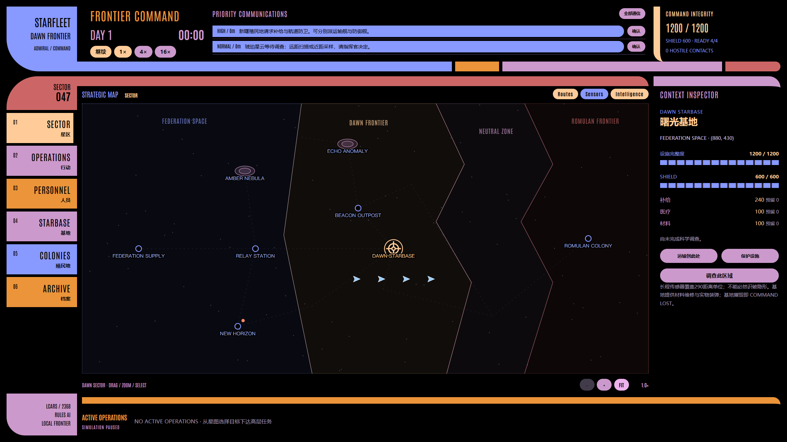

# STARFLEET: FRONTIER COMMAND

边疆指挥 · LV1 世界基础返工 · 存档 v5

玩家是 Dawn Frontier 的 Admiral：观察持续运行的世界、接收通信、制定任务、分配舰船与资源。执行者是明确标注的**确定性规则 AI**；当前不接 LLM，不包含成长、造船或制造系统。



## 运行

```powershell
npm ci
npm run dev
# 或构建并运行 Electron
npm start
```

源码是本次交付。既有 release 目录属于旧构建，本次没有重新制作发布包。

新世界暂停于 Day 1 00:00。地图选择新曙殖民地后，从右侧创建运输或防御；选择琥珀星云可创建探索。OPERATIONS 也可创建任务。建议 Antares Transport 运送30补给，Peregrine Patrol Craft 保护殖民地，Constitution 调查星云，Galaxy 作为增援。

点击 1×／4×／16× 与“继续”推进时间。新接触、敌对确认、调查决策、严重舰损和失败会暂停，请阅读顶部通信并继续。调查到场后从底部行动打开 Inspector，选择远距或近距方案。结算后仍须返航，抵港后才能再次派遣。

## LCARS 指挥终端

顶部 Communications、时间和战略状态；左侧六项导航；中央 Strategic Map；右侧 Inspector；底部 Active Operations。管理页面覆盖地图，不改变地图尺寸。所有时间、地图、任务、关闭、确认、危险操作、装弹与通知控件统一为 LCARS 色块、粗条和圆角几何。

地图 FIT 是最小缩放，完整世界铺满视口；可缩放至8×，围绕鼠标缩放，边界内拖动。Resize 保持 FIT 或放大后的世界中心。远景显示区域与主要地点，中景增加设施与舰名，近景增加传感器；标签按屏幕尺寸避让。投影横纵独立，战斗距离仍使用世界坐标。

## 三类真正不同的行动

| 行动                | 决策与消耗                                                               | 结算                                                                   |
| ------------------- | ------------------------------------------------------------------------ | ---------------------------------------------------------------------- |
| Battle / Defense    | Objective、Priority、ROE、Assets、Withdrawal；能量、鱼雷、舰体与防御窗口 | 目标存续及可观察战果；失联不等于击毁；单舰撤退允许其他资产继续         |
| Cargo Transport     | 起点库存预留、装货、货舱、航线、卸货；抢掠造成真实货损                   | 实际交付和报告；不足、舰损、设施毁坏或超时失败；取消返航回收剩余货物   |
| Exploration / Recon | 科学／传感器适配、远距扫描或近距采样；扫描耗能，近距有辐射损伤           | 获得真实情报／调查成果，返航；同一成果不重复奖励，记录影响后续安全路线 |

Phaser 消耗 Core，Photon／Quantum 发射即扣实物弹药，未命中不返还。Peregrine 只有 Pulse Phasers；Constitution 配 Phaser + Photon；Galaxy 配独立 Phaser Arrays + Photon + Quantum。装弹必须指定数量并预留基地弹药，按发转入舰船，材料不能代替弹药。维修按修复量消耗材料，运输材料不会自动维修设施。定期外部补给按游戏时间提供明确入库清单。

海盗从边缘进入，比较战利品、护航、距离和情报，抢掠真实库存后撤退。Romulan Scout 按覆盖缺口与风险侦察，报告影响 Valdore／D’Deridex 的目标选择；防御过强、报告过期或收益不足时可以不攻击。

情报从 UNKNOWN 到 TRACKED，基地传感器不是全图透视。失联坐标冻结，标记逐渐变淡，30游戏分钟后过期；Renderer 不持有隐藏敌舰、决策状态或随机源。

## 永久损失与时间线

舰船 Hull=0 永久进入 Archive，货物损失、任务结算、操作者权限撤销同步发生，不会拖航复活。操作者身份和舰船分配独立保存；当前舰损只使执行主体不可用，不宣称已实现 Agent 死亡机制。

Dawn Starbase 有 Hull／Shield，能被攻击。基地毁灭立即 COMMAND LOST，不能再推进或下达游戏命令。可恢复上一游戏日00:00或开始新边疆：例如 Day 3 失败恢复 **Day 2 00:00**，创建新分支，失败记录原样保留。Day 1 没有昨日快照，恢复按钮禁用。

v5 位于 Electron 用户数据目录（通常 `%APPDATA%/frontier-command`）：`timeline-v5.json` 与 `frontiers-v5/frontier-******/`。每分支包含 head、备份、独立 day-N 午夜快照及 failure 终态。旧版存档保留，不读取或迁移；重启暂停，不离线推进。写入失败不会切换到新世界。

## 验证与文档

```powershell
npm test
npm run build
npm run test:e2e
```

测试使用隔离临时存档。Electron E2E 覆盖实际 UI 行动、舰损、COMMAND LOST、恢复分支、午夜快照、真实装弹、侦察决策以及1920×1080／1600×900地图和抽屉。实际记录见 [verification](docs/verification.md)，规则对应证据见 [acceptance](docs/acceptance.md)。

- [架构与权限边界](docs/architecture.md)
- [世界设定与规则](docs/worldbuilding.md)
- [演示步骤](docs/demo-script.md)

LCARS 几何与配色以本项目历史提交 `b1d55b7` 的 Classic LCARS 为基准重新组织。视觉灵感来自 TheLCARS.com 与 Michael Okuda 的原设计；代码、地图和图标为本项目实现。Antonio 字体使用 SIL OFL。Star Trek 标识属于其权利人，本项目为非官方学习展示；舰型混编与数值属于游戏抽象。
