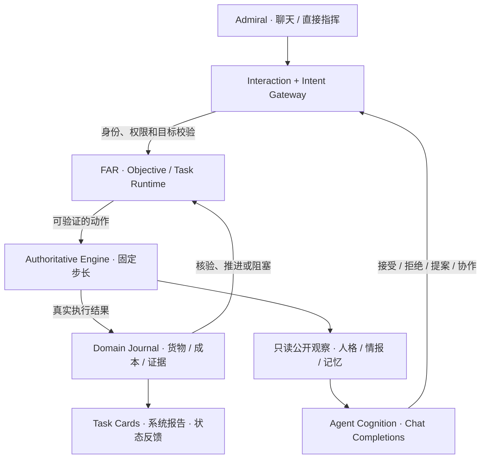

<p align="center">
  <a href="./README.md"><strong>简体中文</strong></a> · <a href="./README.en.md">English</a>
</p>

<p align="center">
  
</p>

<h1 align="center">Frontier Command · 星际边疆</h1>

<p align="center">
  <strong>你负责经营一片星际边疆。至于员工愿不愿意执行命令——他们自己决定。</strong>
</p>

<p align="center">
  单机 Agent MMO 生态模拟经营 · 持续运行的星际世界 · 可验证的自主行动<br/>
  Electron · React · TypeScript · LCARS 26 Classic · v1.6.0 / Save v16
</p>

<p align="center">
  <a href="#30-秒了解游戏">游戏亮点</a> ·
  <a href="#从一个故事开始">真实玩法</a> ·
  <a href="#立即试玩">立即试玩</a> ·
  <a href="#系统如何工作">技术架构</a> ·
  <a href="#agent-协作演示">Agent Demo</a> ·
  <a href="#验证与边界">验证与边界</a>
</p>

> **这不是一个给策略游戏接上聊天框的项目。** Agent 是真正的游戏参与者：观察有限的世界情报，考虑性格、风险、关系与记忆，选择接受、拒绝、协商或主动行动。它们的决定最终必须交给**权威游戏引擎**执行，接受真实库存、航程、战斗、成本与后果的约束。

## 30 秒了解游戏

**玩家是 Admiral，也是经营者。** 你管理 Federation 的舰队、曙光基地、矿场和殖民地；Battle 与 Logistics Agent 是有自己判断的员工，而不是预先写死台词的“自动执行按钮”。宇宙中还有 Romulan 边境势力，以及靠真实劫掠、销赃和补给生存的 Orion Syndicate。

| 你能做什么 | 为什么这件事有意义 |
| --- | --- |
| **探索未知** · 测绘星区、调查异常、确认虫洞出口 | 情报来自实际发现；新资源和航线改变下一轮决策。 |
| **采矿与运输** · 在矿场生产、派货船装载、选择航路、实际交付 | 货物不瞬移；仓储、载重、预留、途中损失和真实交付共同构成经济闭环。 |
| **指挥与交战** · 巡逻、护航、拦截、秘密跟踪、战斗、夺取设施 | 战斗使用真实舰船参数，船损可能永久；你可以直接指挥，也可以让 Agent 决定。 |
| **经营和成长** · 建设设施、改装舰船、培养学员、管理员工 | Credits、Materials 和员工状态会影响下一次机会、能力与意愿。 |
| **面对有经济目标的敌人** · 改线、护航、截获或尾随 Orion | 海盗要侦察、抢到真实货物、运回基地、维修和扩军；切断其经济链比刷怪更有效。 |

## 从一个故事开始

**想象这样一轮航运。** Mira 的货船要把矿场 Materials 运回基地。航线虽然快，却暴露在海盗侦察范围内。

1. **你提出目标。** Mira 根据可观察的船况、航线风险、个人状态及与同僚的关系，可能接受、拒绝，或提出需要护航的条件。
2. **员工开始协作。** 她可以向 Battle Agent 发起正式请求。对方也有自己的意愿，可能答应、拒绝或反提议；奖励需要 Admiral 批准，并由真实预算托管。
3. **规则接管执行。** 一旦达成承诺，FAR 维护任务目标与步骤；引擎负责维修、会合、装载、跨区航行、虫洞穿越和卸载。无需逐帧调用模型。
4. **世界作出反应。** Orion 只能凭真实传感器和传递过的情报组织拦截。若抢到货，必须带走、返航、销赃，再支付维修或造舰成本。
5. **故事留下后果。** 运输了多少、失去了多少、是否履约，以及信任、压力、经验与关系的变化，都会成为下一轮决策的条件。

**这段是玩法链示例，不是硬编码的必胜剧情。** Agent 是否接受、是否求援以及模型如何措辞取决于实际模型响应和当时的状态；游戏世界依照确定性规则结算。

## 核心设计：让 Agent 的选择具有代价

### 01 / Agent 是操作者，飞船是游戏角色

初始提供不同职业与个性的 **Talia（Battle）**、**Mira（Logistics）**。职业影响专长与决策，但不禁止物理上合法的跨职业行动。Agent 具有长期动机、任务偏好、风险容忍度、工作意愿、疲劳、压力、信任及事件记忆。

- **决策不是装饰。** 模型处理真实任务意图、目标提案、协作取舍与关键通讯；结构化结果必须通过本地权限、能力和参数校验，才能进入世界。
- **拒绝也是玩法。** 不合理的高风险命令可能被拒绝，重要协作可以提出条件；关系与履约结果会影响后续选择。
- **一人一舰的持久分配。** 分舰、换舰、未分舰和直接接管有明确权限与生命周期；未分舰 Agent 不会后台不停消耗模型调用。
- **沟通与行动分离。** 普通移动、采矿、装卸、升级和经验增长不会产生每 Tick 的 LLM 请求或聊天刷屏。

### 02 / 经济不是数字动画

```text
探索星区 → 发现矿藏 → 建造矿场 → 开采 Materials
        → 舰船实际装货 → 规划路线 / 虫洞航行 → 基地卸货
        → 造舰、维修、改装、建设 → 拓展活动范围
                                           ↘ 更多航线与风险
```

矿场具有 **3,000 Materials** 仓位，满仓停止生产；殖民地主要提供 Credits；舰船受到货舱容量、装卸时间、库存和预留约束。真实运输带来的物资用于生产、建设与恢复损失。公司资产、舰船模块、Agent 技能及关系构成不同的成长路径。

### 03 / Orion 不是定时刷新的靶子

Orion 在新世界拥有分散部署的侦察、掠袭、截击、重装和走私舰船，以及隐蔽总部与补给点。它们依靠**局部侦察 → 情报传递 → 集结伏击 → 勒索或登舰 → 返航销赃 → 维修/扩军**维持存在。护航强度、路线变化、损伤、黑市预算与真实库存都会影响海盗下一步行动。**这套敌方经济与战术 AI 是确定性的，不消耗 LLM Token。**

### 04 / 星际世界会记住你的行为

星区按 seed 确定性生成，未发现的地点不会直接泄露给模型或界面。航行可组合普通 Warp、不同风险策略和**已经发现且确认出口**的虫洞。Romulan 不自动等于敌人：侦察、边境关系与交战行为会带来政治后果。永久舰损、货物来源、历史事件、任务完成证据和经济结算进入存档。

## 系统如何工作

**Frontier Agent Runtime（FAR）是任务与 Agent 行动的中间层，不是第二套游戏物理引擎。** 它解决的是“模型说想做什么”与“游戏世界真正发生了什么”之间的鸿沟。



| 设计边界 | 系统负责什么 |
| --- | --- |
| **模型 / Cognition** | 在有意义的节点分析公开事实，做意愿、策略、协作和通讯决策。 |
| **Intent Gateway** | 解析玩家与 Agent 的目标，验证引用、授权及可执行参数。 |
| **FAR / Task Runtime** | 持久保存目标、步骤、依赖、等待、打断、修订、恢复与完成标准；不伪造物理结果。 |
| **Authoritative Engine** | 以固定步长推进导航、碰撞/战斗、资源、物流、殖民地、敌方 AI 与建设。 |
| **Domain Journal / Reply Coordinator** | 记录可核查的执行事实，防止重复交付和结算；重要消息一条请求对应一条主回复。 |

游戏支持 **1× / 4× / 16×** 时间倍率；没有 LLM API 也能进行探索、建设、运输与直接舰队指挥。模型只在需要自主判断的交互中发挥作用。

**继续深入：** [FAR v16 架构](docs/agent-core-v2-architecture.md) · [FAR 交付与审计](docs/agent-core-v2-delivery.md) · [游戏引擎设计](docs/architecture.md) · [世界规则](docs/worldbuilding.md) · [代码验收索引](docs/acceptance.md)

## 立即试玩

当前项目以 **Windows 桌面版**为主要运行与验证目标。请先安装 Node.js（建议使用当前 LTS）和 npm，并确保 Git 可用。

```powershell
git clone https://github.com/yinminghao08/frontier-command.git
cd frontier-command
npm ci
npm run dev
```

`npm run dev` 启动开发模式。若希望先构建再直接启动 Electron：

```powershell
npm start
```

新游戏从 **DAY 1 00:00** 暂停开始。你可以先探索地图、从 Helios 矿场运送物资、在曙光基地管理舰船，然后点击继续推进时间。模型配置不是游玩世界本身的前置条件。

<details>
<summary><strong>更多开发、验证与打包命令</strong></summary>

```powershell
npm run build       # TypeScript + Vite + Electron 编译
npm test            # Vitest 规则测试
npm run test:e2e    # Playwright + Electron 集成测试
npm run package     # Windows unpacked 构建（release 目录）
```

端到端测试需要适当安装 Playwright 的浏览器/运行依赖，且耗时长于普通单元测试。`npm run package` 的 `--win --dir` 为未打包安装程序的 Windows 应用目录，不是安装包生成承诺。

</details>

## Agent 协作演示

想快速看到「自主选择 → 真实执行 → 成长反馈」：

1. 启动游戏，进入 **存档管理器 → AGENT DEMO / 演示存档** 创建隔离场景。
2. 在 **CONSOLE SETTINGS → AGENT API** 配置自己的 OpenAI Chat Completions 兼容 API、模型及 Thinking / Effort；可以给每名 Agent 设置独立模型。
3. 在 Mira 私聊发送：**“请评估当前矿场运输与护航风险。”** 她会根据可见世界自行判断，而非读取预设的同意脚本。
4. 查看 **REQUESTS / 待处理请求**、**Task Card**、**SYSTEM REPORTS / 系统报告**；如有协作条件，批准预算后继续游戏时间。
5. 查看运输、护航、奖励/损失、关系和下一轮决策；也可以在中途存档再加载，检查任务恢复。

完整步骤及独立演示存档命令见 **[demo/README.md](demo/README.md)**。无 API Key 时仍可使用 Admiral 直接指挥，但不会假装离线模型完成自主选择。**API 调用会产生供应商费用，建议用低成本模型先试运行。**

## 与极创二面题目的对应

本项目按《Agent 时代的 MMO 模拟经营游戏》的要求设计：**模拟单机 MMORPG 生态，而不是提供真实联网 MMO 服务器。**

| 题目重点 | 对应实现 |
| --- | --- |
| **Lv1 · 差异化任务** | 战斗、探索、采矿、物流：对舰船能力、注意力、风险及收益的要求不同；Admiral 可直接参与行动选择。 |
| **Lv2 · 反馈循环** | Credits / Materials、舰船模块与设施升级、Agent 经验和状态改变后续活动。 |
| **Lv3 · 模型真实决策** | 两名初始独立 Agent、自愿任务、拒绝/协商、同僚协作、结构化决策与实际执行核验。 |
| **Lv4 · 经营生态切片** | 学员招募培养、岗位分配、奖励托管与兑现、持久公司资产与可反制的海盗经济。 |

> 设计取舍：Admiral 保有明确的**最高指挥权和直接接管入口**；自主 Agent 的同意、拒绝和协作仍由模型处理，两种控制模式被清楚区分。这是有意的玩法选择，而非声称完全复刻题目中的每一条建议。

## 验证与边界

- **仓库记录的 v16 验收**：472 项 Vitest 规则测试及 68 项 Electron E2E 测试通过；详情、范围与局限见 [v16 验证记录](docs/verification/v16/README.md)。这是项目内既有验收记录，不代表本 README 修改重新运行了完整套件。
- **Provider**：支持 OpenAI Chat Completions 兼容接口，凭据在 Electron 主进程本地安全存储；显式不支持的推理选项会报错，不假称已经关闭思考。不同供应商的兼容性和真实 Token 费用需自行验证。
- **存档**：当前使用 v16 时间线；包含受保护的历史版本迁移、世界事件与任务执行证据。存档管理器目前**不提供云同步或导入/导出**。
- **平台与范围**：主要面向 Windows；没有多人联机服务端，也没有内置免费 LLM。AI 生成内容具有非确定性；相同 seed 保证的是游戏世界与确定性规则，不保证模型会说同样的话。
- **许可与素材**：`package.json` 当前标记 **UNLICENSED**，不应误认为使用 MIT/Apache 开源许可。LCARS/字体的相关来源与声明参见 [参考资料](docs/references.md)、[Antonio 许可](docs/ANTONIO-OFL.txt) 和 [字体声明](fonts/NOTICE.md)。本项目为非官方科幻题材创作，与《Star Trek》的权利方不存在官方关联。

---

<p align="center">
  <strong>Frontier Command</strong><br/>
  <sub>Not every order is obeyed. Every consequence is real.</sub><br/>
  <a href="./README.en.md">Read in English</a> · <a href="./docs/agent-core-v2-architecture.md">Explore FAR</a> · <a href="./demo/README.md">Try the demo</a>
</p>
