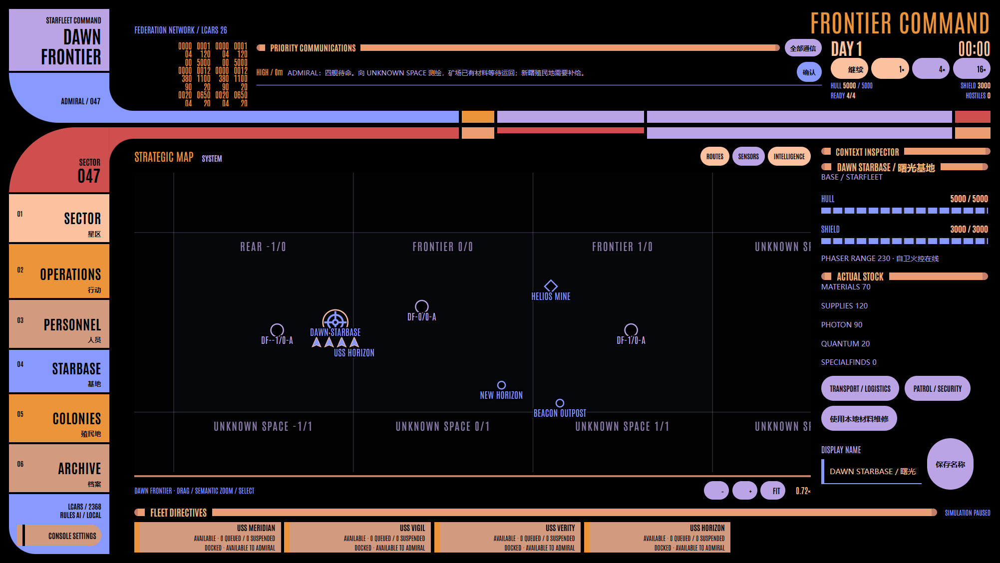

# STARFLEET: FRONTIER COMMAND

**Lv1 + Lv2 / v6 Dawn Frontier。玩家是拥有最终指挥权的 Admiral。**

四艘初始舰船共享一个持续世界：探索产生真实星系与矿藏，采矿和运输创造价值，Orion 通过侦察寻找收益，舰队保卫物流，再将收益转化为新能力。执行者目前是确定性规则 AI；未来 LLM 仅使用观察与结构化动作接口。



## 运行

```powershell
npm ci
npm run dev
# 或完整构建后运行 Electron
npm start
```

新世界暂停于 DAY 1 00:00、默认 1×。沿用既有时间比例：**1× 下约一现实秒推进一游戏分钟**，4× / 16× 只改变固定步次数。重启暂停，关闭时保存，不离线推进。

本次交付源码；release 中已有 EXE/ZIP 属于之前版本。

## 打开后怎么玩

1. 底部直接选择任意舰船，点击“新指令 / 改令”。所有舰船随时可用，无 Operation 锁定。REPLACE 清除旧指令与队列；QUEUE 按顺序接续；INTERRUPT 保留当前进度，临时行动后恢复。已装货物、消耗和损伤保留。
2. VERITY 执行 Explore Sector，选择 UNKNOWN 0/-1。Remote 先取得轮廓；Close 更靠近目标、耗时和风险更高。发现会永久生成星系、行星、矿物带和异常。点击星系可选择其子天体。
3. 从 OPERATIONS 选择已调查矿藏，执行 Mine / Extract：材料逐步进入有限货舱，满舱后卸至指定设施；可循环。开局 Helios 矿场已有库存，可让 MERIDIAN 从 mine 运输 Materials 到 base。
4. 看货运的起终点、实物数量、Safe / Direct / Risky 航线和 ETA。运输本身不产生奖金；基地出口会消耗真实库存换取 Credits。给殖民地运输 Supplies 可维持其收入。
5. 在 STARBASE / ENGINEERING 安装 Expanded Cargo、Long Range Sensors 等模块；SHIPYARD 造新舰；LOGISTICS 升级后可开循环航线。
6. 在已近距调查的资源点、宜居星球或系统建立矿场、殖民地或前哨项目。项目 Inspector 可安排分批 Materials / Supplies 货运；物资实际到达才施工。项目不占有舰船。
7. Orion 接触并非无穷刷怪。截获、护航、驱离或追踪真实舰船；Shadow 返航者可能找到 Hideout。普通接触、发现、报告不自动暂停；严重损伤、重大损失、军事升级和 COMMAND LOST 才暂停。

推荐首次演示：VERITY 探索，HORIZON 采矿，MERIDIAN 运回 100 Materials，VIGIL 巡逻前哨；运输收益到账后改装货舱。注意矿场库存增长引起的 Orion 侦察与袭击。

## 四类活动与 Lv2

| 活动 | 实际机制 |
| --- | --- |
| Combat / Security | Intercept 使用观测速度；Escort 跟随实际舰船；Patrol 守护设施；Shadow 保持接触；Attack 使用能量和弹药；Disable 压制推进，Precision Targeting 可选择 Engines / Weapons；Drive Off 用警告相位炮施压、敌方按风险撤退；Retreat 保留损伤和货物 |
| Exploration / Survey | 按 world seed 与 Sector 坐标独立生成；发现顺序不改变同一 Sector；Remote / Close / Deep Scan 改变信息、危险和隐藏异常；特殊样本一次性进入货舱 |
| Mining / Extraction | 有限矿藏、性能差异、Core、货舱、运输与卸货；矿场消耗 Supplies，将矿藏转入本地库存；枯竭永久保存 |
| Transport / Logistics | 源库存预留 → 真实装载 → 物理航行 → 卸货；Safe 防御绕行、Direct 直接、Risky 快速危险航段；货损和取消保留真实后果 |

Antares / Peregrine / Constitution / Galaxy 分别有 **2 / 2 / 3 / 4** 个模块槽。Deep Scan 发现隐藏异常，Long Range Sensors 扩大感知和探索候选范围，Precision Targeting 解锁定向 Disable，Reinforced Shields 改变危险航线耐受，Expanded Cargo 增加 50 货舱容量。

Starbase 八个独立模块：**COMMAND / SHIPYARD / DRYDOCK / ARMORY / ENGINEERING / LOGISTICS / SENSOR CONTROL / DEFENSE GRID**。Shipyard 解锁高级舰级；Armory 解锁 Quantum 制造；Sensor Network 扩展前哨探测；Logistics 解锁循环货运与中继航速；Defense Grid 解锁防御平台及增强设施相位炮。

Credits 是预算；Materials、Supplies、Photon、Quantum、Special Finds 是实际库存。建设、维修、模块、工业、装弹和出口均有明确消费。舰损永久入档，新舰使用独立舰籍。Dawn 后方拨款与工业从零资源约 240 游戏分钟备齐最低舰级成本，再用 25 分钟建造（1× 约 4 分半钟）；前沿经营收益更高。

## 持久世界、情报与 LCARS

Sector 是 400 单位的稀疏网格，没有矩形世界边界。Dawn 在安全后方；东部有 Neutral Zone / Romulan Border，多方向为未知空间。星系/星球以及己方舰船/设施可改名，稳定 ID 不变。地图自由平移、围绕鼠标缩放，FIT 只拟合已知空间；Sector / System / Local 分别呈现区域、系统和本地实体。新增发现不强制改变视角。

Renderer 只接收只读公开 Snapshot：不包含 world seed、隐藏敌舰/基地、库存、报告或意图。失联接触保留冻结位置并在 30 游戏分钟后过期。Orion 有初始隐藏基地、侦察舰、两艘 Raider 与有限弹药；维修、补弹、重建消耗实物。Romulan Scout 与 Border Command 根据实际报告和 tension 行动，身份本身不授权自动攻击；明确攻击及跨境会留下政治后果。

沿用现有 LCARS 26 Classic shell、字体、控件、动画、音频与 Console Settings。底部展示舰队当前指令、队列和挂起状态；OPERATIONS 展示世界状态派生的机会；COLONIES 管理资产与项目；ARCHIVE 展示永久历史与时间线。

## v6 保存与恢复

数据位于 Electron 用户数据目录中的 `timeline-v6.json` 与 `frontiers-v6/frontier-******/`。**v5 及更早版本不读取、不迁移**，原文件保留。head/备份原子写入；day-N 午夜快照独立；failure 封存终态。恢复上一游戏日新建分支，只有持久化成功后才切换引擎；失败分支保留。

## 验证

```powershell
npm test
npm run build
npm run test:e2e
```

[架构](docs/architecture.md) · [Worldbuilding](docs/worldbuilding.md) · [验收](docs/acceptance.md) · [演示步骤](docs/demo-script.md) · [实玩与验证记录](docs/verification.md)

没有实现 Lv3 LLM、角色生涯或在线多人服务；当前实现的是未来 Agent 可进入的 Lv1 + Lv2 持久生态世界。
