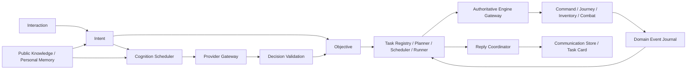

# Frontier Agent Runtime v2

Status: approved implementation specification. Implementation and verification results are recorded separately in `docs/verification/v16/README.md`.

## Baseline and observed conflicts

The published v15 baseline is `c83889a2044616ec5791385ff01337c632b162fc`. Eight existing working-tree changes are preserved in a separate baseline commit. Development uses `feature/agent-core-v2` in an isolated checkout; the original checkout remains untouched.

The actual v15 input path is `sendChat -> appendChat/wakeAgent -> AgentDecisionService.pump -> admiralChatTask -> compileAdmiralIntent -> receiveAdmiralTask`. The same pump can also select `judgeTask` or the large `decide` protocol. Accepted work is advanced by both `advanceAdmiralTasks` and `advanceContracts`; autonomous actions also enter through `applyAgentCommand`, while Standing Orders directly construct directives. `SimulationEngine.complete` calls `agentOutcome`, `contractDirectiveOutcome`, and `admiralTaskOutcome`. All these paths, plus `directiveFeedback`, can append replies. The ordinary Admiral action task equates directive completion with task completion. `compactObservation` and task judgments discard required target/inventory context above 8,200 bytes. Provider compatibility drops explicit reasoning settings. Assignment is persisted twice.

Baseline checks: 26 unit test files / 411 tests passed; renderer and Electron TypeScript checks passed. Build/E2E and measured comparisons are recorded in the verification report, not inferred from those checks.

## Ownership and dependencies

SimulationEngine exclusively owns persistent FAR data and all physical changes. Electron owns cancellable asynchronous requests and secret configuration. Renderer receives public immutable projections. Runtime code uses bounded engine ports; model code cannot access mutable WorldState or submit physical actions. World rules use 0.1 game-minute fixed steps; network timeouts and telemetry use monotonic real time. Determinism compares the same seed and accepted command/decision sequence at the same simulation ticks.

Each interaction has one routing owner. Each objective has one root task. Collaboration creates independently owned objectives linked by dependencies, not a second executor for the same work. Each physical directive records its authorization and submission identity. Existing Command and Action validators remain the physical authority.

## Persistent contracts

- Interaction: interactionId, source, sender, recipient, sourceMessageId, original instruction/structured payload, authorization mode, related objective and routing phase.
- Objective: objectiveId, schemaVersion, originInteractionId, sourceMessageId, issuerId, nullable ownerAgentId, typed goal, constraints, locally derived completion criteria, authorization, status/revision and simulation timestamps. Preserve original text and amendment linkage. Direct commands without an Agent never create a synthetic Agent.
- Task: taskId, objectiveId, owner, state/revision, current step, assigned ships, directive identities, progress, block reason, processed event identities/cursor, completion evidence and recovery state.
- DomainEvent: stable eventId and sequence, discriminated type/payload, sourceId, optional objective/task/directive links, simulationTick. This is separate from narrative WorldEvent.
- Cargo provenance: lightweight attributed batches and transaction receipts. Physical inventory remains authoritative. A receipt observes a transaction; consuming an event never applies inventory changes again.
- ReplyRecord: unique sourceMessageId/recipientAgentId key, request phase and at most one committed primary message. Important later notifications have independent task/event identities.
- Assignment: the only persistent ship/operator link; Agent ship display and current command authority are derived separately.

Schemas use discriminated TypeScript unions and strict Zod validation. Goal families cover transport, recovery, navigation, exploration/survey, patrol, escort, engagement, repair/service, construction and rest, plus the existing diplomacy/event capabilities. The engine constructs completion criteria; models cannot provide executable predicates.

`TaskHandler.validate(objective, observation)` checks legality; `plan(objective, task)` produces deterministic steps; `advance(task, event)` consumes facts once; `verifyCompletion(task, authoritativeReadView)` returns evidence or a reason that the full goal remains unmet. Planning and ordinary progress never call a model.

`submitInteraction` handles addressed chat at message insertion, structured UI commands, collaboration and eligible opportunities. The service does not scan old messages. `reviseObjective`, `cancelObjective`, and `resumeObjective` require expected revisions. `commitCognition` accepts one purpose-specific schema and checks the request/world session/authorization/configuration/assignment generation. `submitDirective(taskId, actorId, command, expectedRevision)` validates permissions, task revision, association, target, resources, inventory, journey and ROE, and returns a deduplicated submission receipt. `fetchModels` runs in main and never returns credentials.

## Lifecycle and interruption

Objective proposal may negotiate, accept or reject; acceptance creates eligible task work. Tasks transition proposed -> accepted -> running. Accepted/running work may block or interrupt. Blocked work resumes only after relevant fact changes and revalidation; interrupted Agent work requires explicit Admiral resume. Completed, completed_partial, failed and cancelled are irreversible. Queue position is scheduling data, not an overloaded lifecycle state.

Direct authority outranks accepted voluntary work, which outranks autonomous opportunities and Standing Orders. Preserve existing physical QUEUE/REPLACE/INTERRUPT rules. Direct takeover preserves an Agent objective, progress, cargo, escrow and commitments as interrupted rather than silently failing or replaying it. Explicit cancellation settles once. Continuous REST still requires continuous time after interruption. Resuming paid/reserved work must not charge, reserve or transfer twice.

Journal consumption runs at command/fixed-step transaction boundaries, never recursively inside complete callbacks. Ordinary directive completion creates a fact, not objective success. Combat completion requires publicly confirmed outcomes; private enemy destruction cannot leak through task status.

## Vertical slice semantics

Mine load/return: navigate to the real source, LOAD actual goods, verify the receipt, RETURN, verify arrival and cargo retained. LOAD is an additive existing-system Action using capacity, unreserved stock and the existing loading duration. Prefer full hold; when source inventory is short, load all currently available stock. Zero inventory without task goods blocks until actual production. Only an explicit delivery goal adds UNLOAD. RETURN, HAUL, UNLOAD and RECOVER retain their v15 semantics.

Scout recovery/delivery: enroll discovered matching wrecks and their available Materials, RECOVER real stock, return/unload in multiple trips, and continue enrolling matching discoveries until closure. At completion, refresh the public set and prove each enrolled amount delivered with no outstanding attributed goods or unexplained loss. Discoveries after the terminal transition do not reopen the task. Pre-existing/mixed cargo cannot prove recovery. Third-party collection and cargo loss produce honest blocked/partial outcomes. Newly generated wrecks preserve source identity/class; legacy classification uses trustworthy loss records, otherwise it remains unknown and requires clarification.

Remove mining accidents triggered by extracted quantity * hazard >= 180. End old active accidents during migration with a rule-removal historical outcome; stop associated repair work without success XP or breach penalty. Preserve spent resources. Capacity and depletion remain effective.

## Cognition, knowledge and communication

Use separate TaskJudgment, ObjectiveProposal, CollaborationDecision, CommunicationDecision and StrategicDecision schemas. Simple unambiguous commands and structured UI input are deterministic. Composite/conditional/referential input uses semantic interpretation, followed by local entity, authorization and world validation. Follow-up commands use the persisted original goal; substantive voluntary amendments require new consent.

Observations are built for the decision purpose. Mandatory instructions, goals, constraints, targets, commitments and execution evidence are never byte-trimmed. Optional memories are ranked by relevance. If mandatory context cannot fit, return an explicit context error, not an incomplete task. Knowledge distinguishes public current facts, personal experiences, commitments/relationships and causal recent results. Hidden geography, enemy plans, stocks and RNG remain private.

Scheduler admissions are addressed player input, meaningful collaboration, novel actionable opportunity, material danger/failure/strategy change, or a valuable social event. Per-Agent single flight, stable event identity, coalescing and priority prevent repeated cancel/restart on low-value changes. Unassigned Agents have zero autonomous requests, automatic retries or unsolicited peer requests; player-initiated conversation still works. Engine reports/acknowledgements cannot trigger peers.

Only Reply Coordinator commits primary replies. Failure/cancel/retry changes the response lifecycle without emitting another primary message. Ordinary progress updates Task Cards. Factual task statuses, quantities and completion language derive from engine evidence; model text expresses intent, subjective choice and explanation. Contracts preserve versioned offers, conditions, escrow, bounded counteroffers, actual rendezvous/dependencies and one-time settlement. Chat is never contract truth.

## Provider gateway

Keep OpenAI-compatible Chat Completions, safe storage and cancellable SSE/JSON transport. Separate provider adapters, model registry, request manager and response validation. Global connection/defaults and Agent model/thinking/effort overrides are independent. Thinking supports provider-default/on/off; inheritance is null. Legacy effort=none migrates to provider-default, because it formerly meant omission rather than a proven off switch.

Capabilities are supported/unsupported/unknown with provider/model/evidence scope. Model directories do not establish reasoning capabilities. Use documented model-specific off mappings; unknown forced settings fail visibly rather than silently changing reasoning. Negotiate strict schema, tool output, JSON object or validated text JSON separately. No format fallback changes thinking. Maximum two compatibility retries and one format repair, four HTTP attempts per stage; authority/world drift is not model repair input. Default connection timeout 30 seconds and idle-body timeout 120 seconds; configurable and cancellable, without a total deadline on a progressing stream. Per-purpose output budgets distinguish visible output and reasoning-inclusive limits.

Model fetching accepts API root, version root or full chat endpoint while preserving provider path prefixes; unsupported listing leaves manual model input functional. Telemetry records per-Agent purpose, attempts, input/output/reasoning tokens, connection/first-byte/first-content/generation/validation/repair/total durations, with unknown usage retained as unknown. Do not store API keys or reasoning bodies in game saves, renderer snapshots or logs.

## Replacement map and staging

| Existing file(s) | Final responsibility |
|---|---|
| admiral-intent.ts | Intent Gateway; remove legacy regex task compiler |
| admiral-tasks.ts / admiral-task-schema.ts | Objective/Task Runtime and frozen legacy migration |
| agents.ts | Agent state, small decision validation/commit |
| chat.ts | Communication Store; scheduler/coordinator own triggering/replies |
| contracts.ts | Coordination/settlement; runtime owns physical work |
| projection.ts / context.ts | Public projection and purpose-based knowledge |
| decision-protocol.ts / task-judgment.ts | Purpose-specific schemas |
| service.ts | Cognition Scheduler; no transcript scanning |
| client.ts / transport.ts / runtime.ts | Provider gateway/telemetry |
| command-system.ts / execution.ts / inventory.ts | Existing physical authority, LOAD and causal receipts |
| directive-feedback.ts | Domain/communication intents, no independent primary replies |
| saves.ts / save-schema.ts / persistence.ts | Frozen v15, v16 validation and atomic timeline migration |
| services.ts / world-events.ts | Remove periodic mine shutdown; preserve other ecology |

Phase 0: preserve baseline, freeze published v15, commit this reviewable specification.
Phase 1: implement interaction -> objective -> runtime -> engine -> event -> reply, LOAD, both real logistics scenarios and single ownership.
Phase 2: migrate all task/standing/coordination behaviors. Disconnect old global advancement; any temporary adapter is only called by its sole TaskHandler and is removed before completion.
Phase 3: migrate cognition, communication, knowledge, provider and telemetry.
Phase 4: LCARS task cards, authoritative assignment labels, model directory/configuration, response lifecycle and persistence.
Phase 5: remove adapters/duplicate paths, regression, fault injection, benchmarks and actual Electron QA.

## Persistence and acceptance

Freeze v15 validators from the published commit before changing live types. v16 stores timeline-v16.json in userData and branch files under frontiers-v16/. Preserve original v15 files and retain v14 import. Validate old input before migration; stage every head, backup, daily snapshot and terminal record together with a recoverable publication marker. Preserve identities, cargo, reservations, paid work, contracts/escrow, histories and settlement markers. Unknown legacy cargo is unattributed; missing evidence is recorded rather than fabricated. Preserve old transcript and index already committed replies. Old in-flight requests become explicitly retryable and cannot commit into the restored world.

Required tests: full/short/empty source load-return and optional delivery; dynamic multi-trip recovery/mixed cargo/loss/full destination; objective consent/takeover/resume/queues; Frontier 0/12 versus body survey; confirmed combat; escort rendezvous/conditions/settlement; zero autonomous unassigned/model-on-progress calls; primary reply identity; schemas/provider settings/directory/fallback; malformed/truncated/disconnected/timed-out/cancelled/late responses; in-progress save/reload/speed/determinism and migration interruption; removed mine accidents with capacity/depletion preserved; actual Electron card/chat/ship/inventory/configuration consistency.

Run npm run build, npm test and npm run test:e2e against isolated data. Record screenshots/logs. Compare baseline and FAR on identical local-provider scenarios: requests, request bytes/schema size, corrections, cancellations/restarts, task advancement cost and p50/p95. Mock duration and estimated tokens are not real provider performance/cost. This delivery does not access player production API configuration. Report real-provider validation as not performed.

## Implementation checkpoints

Phase 1: the authoritative Runtime, LOAD, cargo provenance, journal cursor, root-task identity, primary-reply ledger, interruption checkpoint and v16 save/timeline migration are implemented. Seven real-engine vertical tests pass (full/short/empty loading, multi-trip discovery-aware recovery, cancellation, explicit resume after reload and deduplication). Full regression currently passes 393 of 418 tests; obsolete mine/notification/state assertions and remaining migration integration are being addressed in the following phases. This checkpoint does not represent completion of the cognition/provider/UI migration.

Phase 2 integration: root tasks now own preserved operation/construction/survey/faction handlers, coordination execution is invoked exclusively by the Runtime, and Standing Orders acquire traced roots. Directive success is checked against world facts (arrival, attributed inventory, survey level, target loss, service state and continuous work), not model statements. Fixed observation clipping and growth/fatigue-50 wakeups were removed; a local Mock test proves unassigned Cadet 28 performs zero background HTTP requests and one player-chat request. The purpose protocols, canonical Assignment persistence, dependency projections and final UI consolidation remain in progress.

Provider capability evidence (checked 2026-10-09): [GPT-5.1](https://developers.openai.com/api/docs/models/gpt-5.1), [GPT-5.2](https://developers.openai.com/api/docs/models/gpt-5.2), [GPT-6.1 Sol](https://developers.openai.com/api/docs/models/gpt-6.1-sol), [GPT-6 Astra](https://developers.openai.com/api/docs/models/gpt-6-astra), and [DashScope thinking models](https://www.alibabacloud.com/help/en/model-studio/deep-thinking). The registry distinguishes documented capability from unknown capability and preserves API prefixes when discovering models. Six registry tests use injected local Mock responses; this is not live-provider verification, and the registry is being wired into the final Gateway/UI.

Phase 3 checkpoint: production scheduling now uses engine-session cognition tickets and purpose-specific intent, judgment, collaboration and strategy requests. The model host has no Action submission port. Exact one-step parsing leaves compound/referential input to the semantic gateway; all references are checked against public facts. Ordinary directive completions no longer invalidate a pending player conversation. The old negotiation ledger currently has an engine-local adapter; legacy mixed command/client test APIs are scheduled for removal during consolidation and are not the production scheduler path.

Provider integration now preserves explicit thinking parameters, negotiates schema/tool/object/text output independently, restores output budgets, shares a four-HTTP-attempt limit across compatibility and repair, and implements connection/idle deadlines and cancellation. Fetch Models is available over trusted IPC and LCARS settings; thinking overrides remain separate from effort and inheritance. Twelve new cognition/gateway tests use only injected Mock providers. The targeted six-file set passes 87 checks. The wider suite currently passes 394/432; remaining failures include legacy provider fixtures and changed notification/intent expectations and remain outstanding. No live-provider or final Electron acceptance claim is made at this checkpoint.

Phase 4 checkpoint (2026-10-09): Assignment is the sole persisted ship/operator relation; Agent ship fields are derived and rebound after validation/engine cloning. Task revisions retain the same Objective/root identity, cargo provenance, checkpoints and history, and substantive voluntary revisions require fresh agreement. LCARS Task Cards share the public projection between communications and Agent detail, with evidence, history, revision, cancellation and explicit resume. Canonical vessel labels distinguish assignment from Admiral takeover. The current build passes and the targeted seven-file suite passes 103 tests. A dedicated actual Electron scenario verifies model fetching/overrides, compound load-return, retained cargo during revision, actual delivery and one primary reply using an isolated local Mock. This is a checkpoint, not full acceptance: the previous full regression had 38 failures, final protocol/handler/dependency consolidation and performance comparison remain outstanding. See agent-core-v2-handoff.md for the resume priorities.

Consolidation checkpoint: Standing Orders now submit through the Task Gateway rather than creating and later adopting a Directive. Safety interruption preserves a checkpoint, and autonomous roots require explicit resume after Admiral interruption. Frozen-v15 raw/current/queued/suspended directives acquire authorized roots without cargo/payment/XP replay; suspended Agent work becomes an explicit checkpoint. Actual repeat-haul cycles have journal identities. Persisted dependencies record completed preparation/logistics or actual escort rendezvous, reject cycles, and carry authoritative proof events. Physical outcomes are consumed before coordination planning to prevent reissuing a just-completed REST. The production negotiation path now validates purpose responses directly against the contract ledger and no longer builds AgentDecision. Seven relevant test files pass 101 checks; the old mixed client/command tests and final Handler ownership consolidation are still outstanding.
