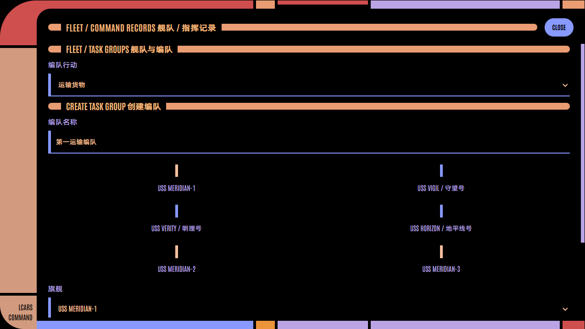
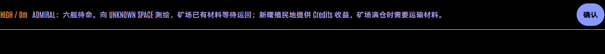
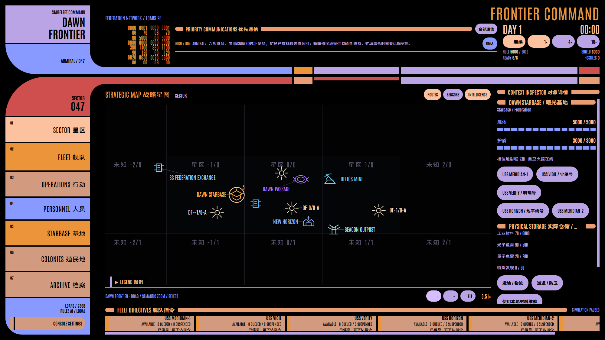
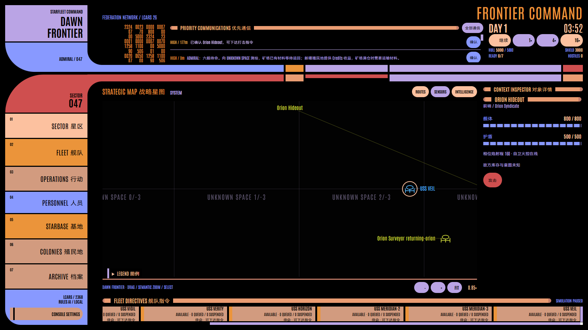

# Frontier Command / v8 验证记录

验证日期：2026-10-05。基线为 GitHub main `7131c31`；保持现有主进程引擎、事件、指令和 LCARS 26 Classic 架构。旧验证存档、夹具和脚本已替换为严格 v8，用户的旧世界目录没有修改。

| 检查 | 结果与证据 |
| --- | --- |
| `npm test` | 10 文件、145 项通过；[机器结果](verification/v8/unit-last-run.json) |
| `npm run build` | TypeScript、Vite 生产资源、Electron 主进程编译通过 |
| v8 世界玩法全量 Electron E2E（上轮验收） | 23 项通过；[机器结果](verification/v8/electron-last-run.json) |
| 本轮 LCARS 与管理 UI 回归 | 11 项通过；[机器结果](verification/v8/typography-ui-last-run.json) |
| 本轮字体、标题栏与地图专项 | 3 项通过；[机器结果](verification/v8/typography-layout-last-run.json) |
| 真实正常世界实玩 | seed 236807，通过；[记录](verification/v8/acceptance-236807.json) |
| 字体、三层地图、三个显示缩放级别专项 | 125% / 150% / 200% 全部通过；[字体实测](verification/v8/layout-fonts-125.json) |

## 经济、指挥和持久世界

规则验证覆盖矿场 3000 Materials 满仓停产、一次报告与运输恢复，有限矿藏、事故、Colony Credits 产出、一次建设/造舰预算、现场医疗与真实物资守恒。库存、命令和严格保存只允许 Materials / Photon / Quantum / Special Finds；额外库存键与 v7 存档被拒绝。

默认 Standing Orders 下，在远离 Dawn 的位置分别模拟空闲、低弹药、非战斗低状态、指令完成、取消和重启，连续 1440 游戏分钟坐标不变。任务失联后仅搜索自身最后观测位置，结束后待命。紧急战斗脱离使用本地退避状态，并验证 Admiral 可立即改令；RETURN / DOCK、REPLACE / QUEUE / INTERRUPT、预留与编队仍有独立验证。

持久化检查包含严格 v8 保存、旅途中与暂停货运恢复、每日快照、事务性分支恢复、永久舰损、跟踪证据、甩尾状态、部分地点情报和隐形。1× / 4× / 16× 重复相同固定步并得到相同世界结果。

## 生成与秘密尾随

多个 seed、多个坐标和不同探索顺序验证每 Sector 1–2 个系统、每系统 0–3 个行星、最多 6 个次级天体，以及 180 / 70 / 60 的系统、恒星和天体间距。固定 0/0 ↔ 0/12 Wormhole 独立于随机概率；唯一 Veil 接管、延误、重启、改名和永久舰损均有规则验证。

Orion 与 Romulan 的普通舰 SHADOW 实测积累物理暴露证据并触发假航点；甩尾优先于所有返港分支，已经识别的尾随者持续可见时不得恢复真实返航。隐形 Veil 分别在 42、1701、236807 下秘密尾随到真实目的地，先获得疑似信号，再经历完整 10 游戏分钟连续现场侦察确认基地，随后可对实际设施造成战斗伤害。Romulan 反隐形范围更强。

公开 Snapshot、Agent observation、通信、历史、事件和武器效果验证未知基地、私有意图、真目的地与甩尾航点的边界。Electron 尾随场景使用隔离的合法 v8 夹具；主进程保存中的私有反跟踪状态只用于测试判定，不交给 Renderer。

## 字体和地图截图

原始提供的阿里巴巴普惠体 Regular 与 Medium 均完整保留，并核对 SHA-256 与提供的文件一致。应用的正文和粗体中文均基于 Medium：正文配 Antonio Regular，粗体经过横、竖笔画轮廓校准后配 Antonio Bold；两个独立静态字体文件使用明确的 400 / 700 声明，关闭浏览器伪粗体。字面高度与基线也统一校准；原始混排正文、导航、标题、表单和 SVG 共用该规则。可复现脚本、原始文件散列和轮廓测量见 [字体说明](../fonts/README.md)。

Electron 断网加载字体，通过 Chromium 实际平台字体信息分别确认 Antonio-Regular、Antonio-Bold 与两套 AlibabaPuHuiTiLCARS 字体。100px 参考字号下，舰队指令与优先通信的中英上下边界和高度差为 0，另两组标题的差不超过 2px；实际抗锯齿笔画测量中，正文横竖差低于 8%，粗体横笔画差为 0、竖笔画差约 0.9%。125%、150%、200% 均达到高度差 ≤2px、笔画差 ≤10% 的标准，见 [125%](verification/v8/layout-fonts-125.json)、[150%](verification/v8/layout-fonts-150.json)、[200%](verification/v8/layout-fonts-200.json)。

所有管理页面、Admiral 指令窗口与八个 Starbase 模块逐一检查共用标题栏。左右色条均为 `rgb(234, 156, 114)`，所有边框宽度为 0，保留原有长度、圆角和黑色间隔。展示截图使用正常舰名；80 字符长名称只用于独立压力测试。

[acceptance-typography.mjs](../scripts/acceptance-typography.mjs) 在三档缩放分别启动可见的真实 Electron 窗口，以隔离目录创建正常世界，仅通过 UI 操作，确认实际粗体字体、正常舰名与离线加载，没有页面错误；[可见窗口结果](verification/v8/typography-native-result.json)。

六种窗口尺寸、八个 Starbase 模块、80 字符长名称、焦点、动画与实际音频均由原有 Electron 用例检查。三层地图分别检查实际 DOM 标签无重叠、Sector 层隐藏次级天体、Dawn 语义色和离线字体。全部截图均来自实际 Electron 页面。

## 正常新世界实玩

[acceptance-v8.mjs](../scripts/acceptance-v8.mjs) 启动可见的生产 Electron，使用正常 `createWorld(236807)` 和隔离用户目录。保留全部持久敌舰与设施，不注入库存，不直接推进引擎时钟；随后修改只通过真实按钮、表单和生产 Command。

初始仓储确认 Mine 3000。向 Vigil 下达 MOVE，完成后观察 60 游戏分钟，位置保持不变、无新指令。Verity 通过固定 Wormhole，现场 SURVEY 和 ASSIST_EVENT 接管幽影号，再通过 Inspector 开启隐形。所有步骤保留真实截图和公开结果；保存成功且无页面错误。

初始、待命与接管截图分别为 [start](verification/v8/236807-start.png)、[idle](verification/v8/236807-idle.png)、[veil](verification/v8/236807-veil.png)。这些正常世界实玩证据与规则/UI 隔离夹具分开记录。

本轮交付源码和生产构建。原 release 中的 EXE / ZIP 没有重新打包或发布；启动最新实现使用 `npm start`。没有接入 LLM 或开始 Lv3。
