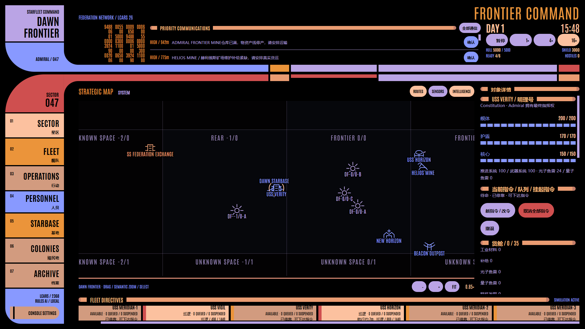
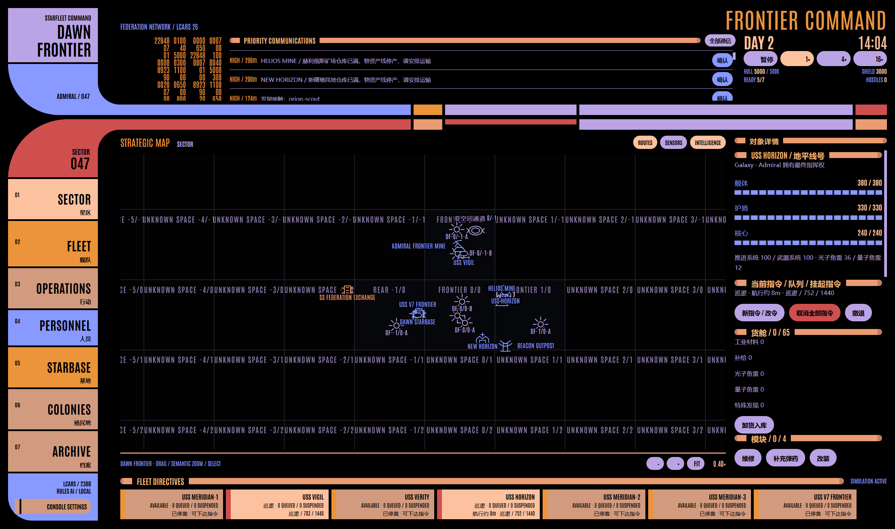

# Frontier Command / v7 验证记录

日期：2026-10-05（UTC+8），Windows x64，分支 `codex/lcars26-classic-console`。v6 记录封存到 [verification-v6.md](verification-v6.md)，旧经济与旧测试数量不作为本轮证据。

## 构建与自动化

| 检查 | 结果 |
| --- | --- |
| `npm test` | 9 文件、123 项通过；[机器结果](verification/v7/unit-last-run.json) |
| `npm run build` | 严格 TypeScript、Vite、Electron 生产构建通过 |
| `npm run test:e2e` | 15 项真实 Electron 用例通过；[机器结果](verification/v7/electron-last-run.json) |
| 正常世界实玩 | seed 236807、42、1701 完整经济链通过 |
| 连续 1× 观察 | 默认种子 601005 ms，超过十分钟；全程未暂停，游戏时间持续推进 |

最终测试额外使用 JSON reporter 保存机器结果，运行内容与上述 npm 脚本相同。没有添加 Renderer 测试写入接口。

规则覆盖设施分货种容量、满仓停产/恢复、断供衰减、库存/预留守恒、部分卸货、工业满仓等待、实物进口/出口、商船货损、全舰损后付费重建；编队总量分摊、最慢舰速、队形、原子失败、成员损失和单舰覆盖；Admiral 当前/挂起/队列优先于常备命令；人员培养、任职会合及岗位效果；事件触发证据、拒绝/延误、后果与续存；Wormhole 配对与未知出口；局部生成种子独立；Scout 本地/共享情报、Orion 盗抢/返港/付费重建、Romulan 真实资产部署及外交。军事事件不能靠普通科研进度结束，敌方设施只能对实际攻击者还击。

Electron 验证地图实际鼠标坐标 MOVE、REPLACE/QUEUE/INTERRUPT、拖动不下令、Esc 取消、高亮保留；编队增删改、成员和组令；地图各独立图标与中文 Inspector、人员/事件入口；80 字符长名称、中文标题端帽；六种分辨率、125/150/200% 缩放、八个 Starbase 模块、字体、动画、真实音频、键盘焦点、保存重启和事务性时间线恢复。规则/UI 用例使用隔离夹具；这些夹具的库存修改不混入下面的正常世界实玩证据。

## 正常新世界实玩

[acceptance-v7.mjs](../scripts/acceptance-v7.mjs) 启动可见生产 Electron，使用独立临时 userData。初始化只调用正常 `createWorld(seed)`；之后所有修改通过真实按钮、表单和生产 Command。未注入库存、删除敌人或调用引擎 step/直接推进时钟。航行使用 UI 的 16× 倍率，默认种子另观察十分钟 1×。原始日志保留失败尝试，以最后一次正常初始化后的成功段为当前结果。

| Seed | 开始 → 结束（2026-10-04 UTC） | 最终游戏分钟 | 新矿场满仓 | Dawn 材料：运回后 → 造舰后 | Orion 压力 | 页面错误 |
| --- | --- | ---: | ---: | ---: | ---: | ---: |
| 236807 | 16:51:47.829 → 17:03:48.242 | 2285.3 | 600 | 640 → 620 | 84.26 | 0 |
| 42 | 17:25:51.571 → 17:27:26.206 | 1409.6 | 600 | 640 → 620 | 49.59 | 0 |
| 1701 | 17:07:03.251 → 17:08:43.046 | 1486.4 | 600 | 640 → 620 | 48.40 | 0 |

每个世界均完成：探索新 Sector 0/-1 → 调查矿藏 → 将现场建设物资实际运抵 → 建矿场 → 600 Materials 满仓停产并请求运输 → 三运输舰编队 HAUL 运回 600 → VIGIL 实际护航 → 真实殖民地 Supplies 运到 Dawn → 支付 20 Materials、10 Supplies 与预算造出独立舰籍 `USS V7 FRONTIER` → Cadet 支付培养、毕业并任职 → 处理持续矿场事故或科学事件。Dawn 材料从运输前 40 增至 640，再因造舰减少到 620；没有基地自动资源、发现奖金或舰船采矿旁路。

殖民地日常生产 Supplies 与 Credits；仓储满后物资产线停止，预算继续增加。运输维护补给恢复真实设施功能。默认世界事件响应期间，设备确实停工；现场舰船完成工作并消耗矿场维修材料后才恢复生产。事件与人员变化留在独立持久档案中。

Orion 压力来自真实矿场/货物价值的 Scout 观测和返航共享，而非计时刷舰。此演示持续用 HORIZON 守卫 Helios、VIGIL 护航，不能据此声称每个种子发生 Raider 击毁；真实盗抢、货损、返港、维修和资源不足时不能重建另有规则测试。护航强度改变势力的收益/风险判断。

默认种子连续 1× 的起止游戏时间为 1721.6 → 2284.8；日志逐三十现实秒记录时间、tick、倍率、预算和存活舰数，物理模拟持续运行。结束后通过 Archive 的“立即保存”保存世界，再由生产 SaveStore 严格读回；原始世界文件包含最终库存、己方指令、私有势力情报和永久历史，作为本地验证资料，不属于 Renderer 接口。

原始记录：[236807](verification/v7/acceptance-236807.jsonl)、[42](verification/v7/acceptance-42.jsonl)、[1701](verification/v7/acceptance-1701.jsonl)。[整理结果](verification/v7/play-summary.json) 与 `world-*.json` 保存最终状态。日志中的 wall 是观察时刻；历史条目的 time 才是游戏事件时刻。

## 图像与交付

各阶段截图和高 DPI/长标题复验图在 [v7 验证目录](verification/v7/) 中。图像已打开检查，保留 LCARS 26 Classic；远景星区标签按语义缩放缩短，避免相邻文字重叠。标题条采用共享组件端帽几何与文本截断，修复不依赖逐条覆盖样式。

v7 使用独立存档目录；未迁移或删除旧文件。四个 [v7 存档夹具](../tests/fixtures/v7/README.md) 通过生产校验。本轮交付源码、生产构建与 Git 提交；此前 release 中的 EXE/ZIP 仍是旧版本。没有接入 LLM 或开始 Lv3。
