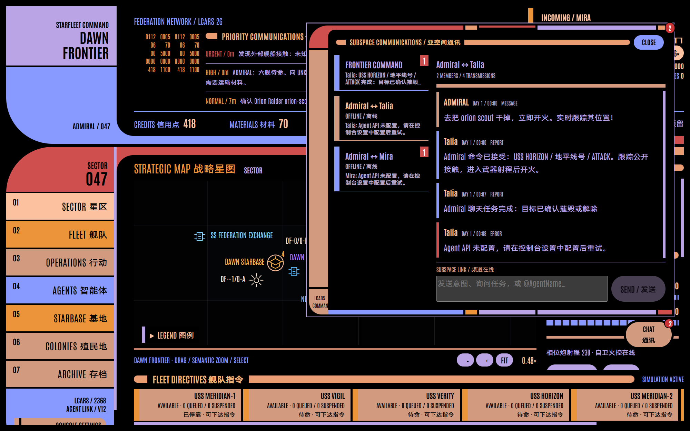
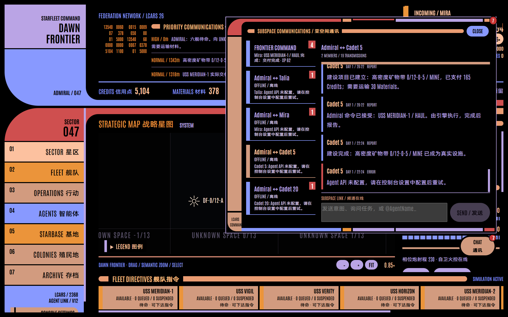
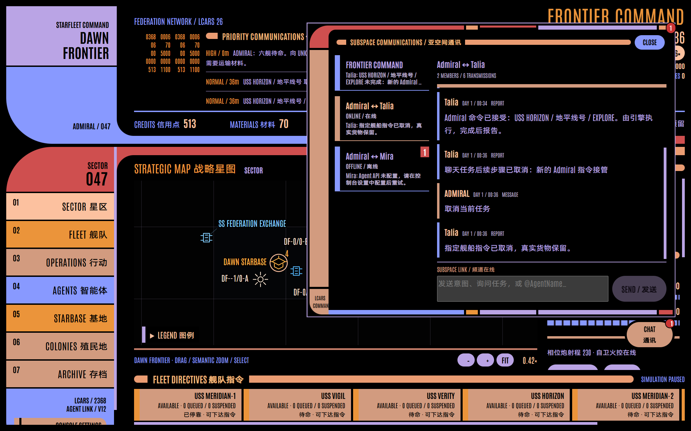
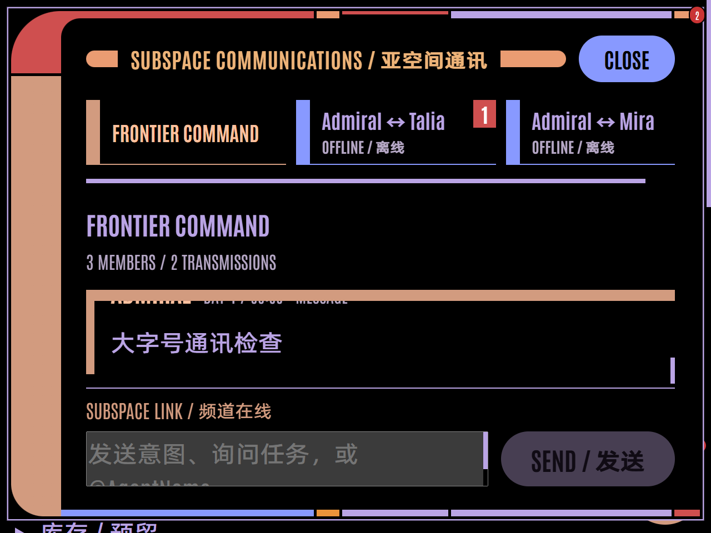

# v12 Agent 决策与聊天指挥验收

2026-10-08，Windows / Electron 41。

- `npm run build`：TypeScript、Renderer 与 Electron main 构建成功。
- `npm test`：18 个文件、241 项测试通过。
- 实际 Electron 针对性验收累计 7 个场景通过：新聊天指挥 3 项，原 Agent 功能回归 4 项；未重跑整个历史 Electron 套件。

## 新闭环

1. 私聊命令攻击公开观测、尚未确认敌对的 Orion Scout：保留 RETURN FIRE 与 hostile=false，真实指令为 ADMIRAL / commander / ATTACK，并记录执行 Agent 和消息来源。真实击毁后进入历史、任务完成和 XP。
2. 复制玩家提供的 v11 时间线及分支，自动迁移为 v12：群聊 `@Cadet 5 USS VIGIL 给你了` 实际更新 Assignment；私聊建设指定 `高密度矿物带 0/12-0-5`，扣 165 Credits、请求空闲 Mira 协作、实际装运 30 Materials，经已确认虫洞运抵项目并完成施工。保存重启仍保留舰船分配和完成任务，原副本的 v11 文件逐字保持不变。测试先在隔离副本中取消 Mira 原本尚未装货的自主运单，为协作释放货船；没有修改玩家正常存档或复制 API 配置。
3. 明确逐区测绘及禁止虫洞：约束和进度保存重启，恢复真实航行；直接 Admiral 指令及聊天取消命令立即接管。引擎测试另验证整段测绘完成、真实物流材料守恒和固定步确定性。

## 模型及边界

本地 OpenAI-compatible 测试服务验证独立模型、NONE、reasoning 参数兼容、严格 Schema 请求、JSON/文本格式降级缓存、非法输出恢复、护航接受/拒绝与真实 HAUL/ESCORT。规则测试覆盖字段纠错、无效目标/数量、共享超时、凭据回显保护、原子校验、伪造授权、私聊隔离、ACK 回复链、群聊流量下私聊保留，以及分支/每日档迁移。API Key 未进入 Snapshot、普通存档或诊断记录。

未调用玩家外部模型服务；第三方 Provider 的实际支持由运行时兼容协商处理。明确常用 Admiral 命令由主进程根据公开信息编译，复杂或含糊的命令需要澄清；逐区路线当前支持同列最多 65 个连续星区。

## 画面

